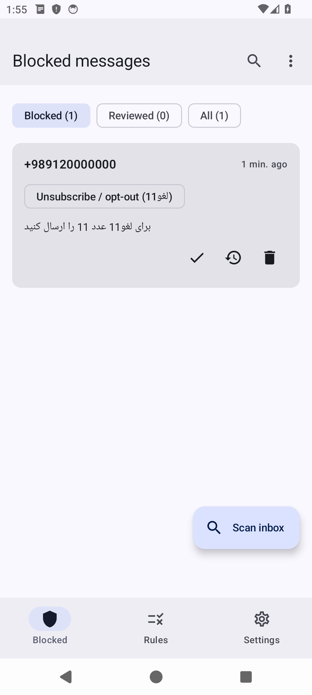
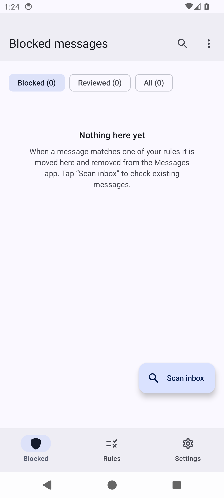
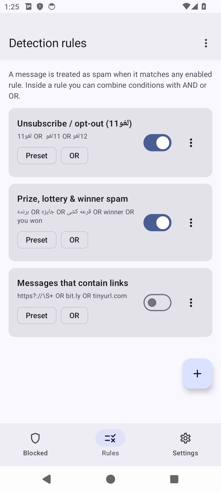
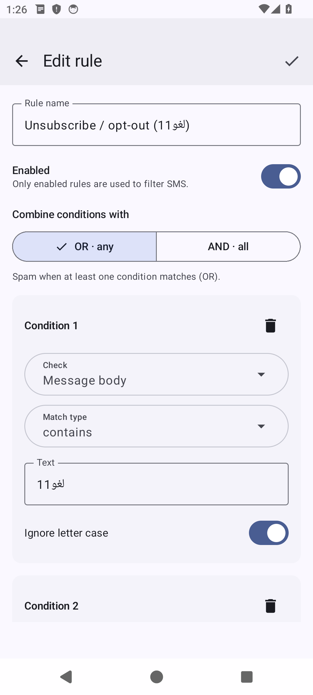
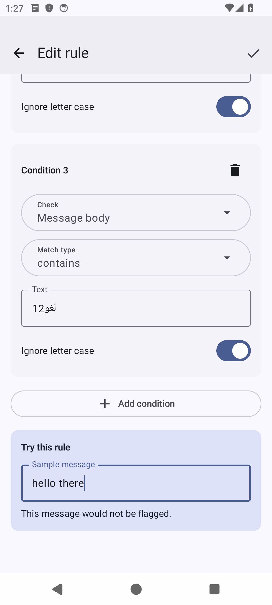
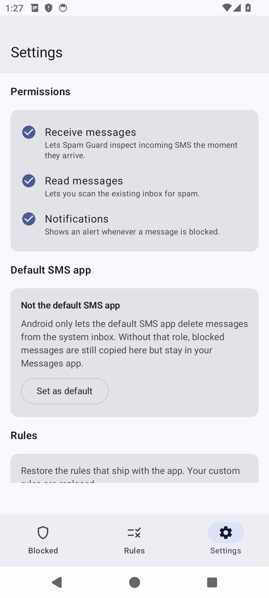
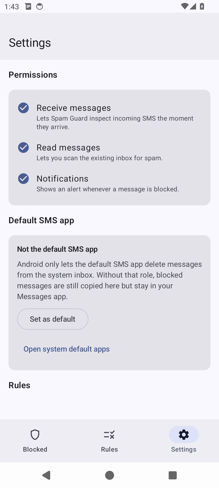

# Spam Guard — SMS spam detector

A modern, Material 3 Android app that filters spam SMS using **rules you build yourself**.
Each rule contains one or more **conditions** (plain text, sender, or a regular
expression) that you combine with **AND / OR** logic — like a tiny programming
language for your messages.

Messages that match a rule are moved out of the system SMS app and kept inside
Spam Guard, so nothing is ever lost and anything flagged by mistake can be
reviewed and restored.

## Screenshots

| Blocked messages | Empty quarantine | Detection rules |
| --- | --- | --- |
|  |  |  |

| Rule editor | Live rule tester | Settings |
| --- | --- | --- |
|  |  |  |

| Default SMS app |
| --- |
|  |

## Features

- **Rule builder** — name, enabled toggle, AND/OR combination and any number of
  conditions.
- **Condition types** — contains / does not contain / equals / starts with /
  ends with / matches regex / does not match regex.
- **Match target** — the message body, the sender, or the whole message.
- **Live rule tester** — type a sample message while editing a rule and see
  instantly whether it would be blocked.
- **Preset rules** — including the requested opt-out rule that catches Persian
  `لغو11` messages. Presets can be edited, disabled or restored at any time.
- **Quarantine** — blocked messages are stored in the app, grouped into
  *Blocked* / *Reviewed* / *All*, and can be marked **not spam**, **restored**
  or **deleted permanently**.
- **Inbox scan** — scan existing messages and move everything that matches your
  rules into the quarantine.
- **Notifications** — get an alert the moment a message is blocked.
- **Default SMS app** — optionally take the system SMS role so blocked messages
  are truly removed from the inbox (see below).
- **Material 3 UI** — dynamic color (Material You), edge-to-edge, dark mode,
  navigation bar.

## Default rules

| Rule | Logic | Conditions |
| --- | --- | --- |
| Unsubscribe / opt-out (`لغو11`) | OR | body contains `لغو11`, `لغو 11`, `لغو12` |
| Prize, lottery & winner spam | OR | body contains `برنده`, `جایزه`, `قرعه کشی`, `winner`, `you won` |
| Messages that contain links | OR | body matches `https?://\S+`, or contains `bit.ly` / `tinyurl.com` (disabled by default) |

## How a message is classified

1. Every **enabled** rule is evaluated against the incoming SMS.
2. Inside a rule, each condition is tested and combined with **ALL** (AND) or
   **ANY** (OR).
3. If any enabled rule matches, the message is treated as spam: a copy is stored
   in the app and a notification is shown.
4. The app then tries to remove the message from the system SMS app.

## Default SMS app

Since Android 4.4, **only the default SMS app** may write to (delete from) the
system SMS provider. Spam Guard can take that role: **Settings ▸ Default SMS app
▸ Set as default** opens the system role dialog. To qualify, the app declares the
components Android requires of a default SMS app:

| Component | Action | Permission |
| --- | --- | --- |
| receiver | `android.provider.Telephony.SMS_DELIVER` | `BROADCAST_SMS` |
| receiver | `android.provider.Telephony.WAP_PUSH_DELIVER` (`application/vnd.wap.mms-message`) | `BROADCAST_WAP_PUSH` |
| service | `android.intent.action.RESPOND_VIA_MESSAGE` (`sms/smsto`) | `SEND_RESPOND_VIA_MESSAGE` |
| activity | `android.intent.action.SENDTO` / `SEND` (`sms/smsto/mms/mmsto`) | — |

While holding the role, incoming SMS are handled directly: spam is kept only in
the app quarantine and is **never written to the inbox**, while normal messages
are persisted to the system inbox and shown as a notification, so nothing is
lost.

Without the role the app still collects blocked messages (best effort, via
`SMS_RECEIVED`) and the *restore* action is best effort.

> **MMS:** Spam Guard does not download MMS content — the WAP push receiver exists
> to satisfy the role requirement. If you rely on MMS, keep a dedicated messaging
> app available.

## Project structure

```
app/src/main/java/com/smsspam/detector/
├── MainActivity.kt            # entry point, edge-to-edge Compose host
├── SpamGuardApp.kt            # Application + notification channel + DI container
├── model/                     # Rule, Condition, QuarantineMessage
├── engine/RuleEngine.kt       # condition matching, AND/OR evaluation
├── data/                      # reactive StateFlow repositories (rules + messages)
├── sms/                       # SmsReceiver, MmsReceiver, quick-reply service,
│                              # compose activity, inbox reader, delete/restore
├── notify/                    # spam + message notifications
└── ui/                        # Material 3 screens, theme, AppViewModel
```

## Build

Requirements: JDK 17+, Android SDK (build-tools 36, platform android-37).

```bash
# point to your SDK
echo "sdk.dir=/path/to/android-sdk" > local.properties

# build the debug APK
./gradlew :app:assembleDebug

# build the release APK + App Bundle (Android App Bundle)
./gradlew :app:assembleRelease :app:bundleRelease

# run the unit tests for the rule engine
./gradlew :app:testDebugUnitTest
```

The debug APK is written to `app/build/outputs/apk/debug/app-debug.apk`, the
release APK to `app/build/outputs/apk/release/app-release.apk` and the release
bundle to `app/build/outputs/bundle/release/app-release.aab`.

### Release signing

Release builds are signed with a real release keystore, read from a git-ignored
`keystore.properties` (local) or `RELEASE_*` environment variables (CI). Create
the keystore once:

```bash
./scripts/generate-keystore.sh
```

This writes `keystore/release.jks` and `keystore.properties` (both git-ignored).
Resolve the signing config for the current checkout with
`./gradlew :app:signingReport`.

> **Back up the keystore.** Cafe Bazaar binds updates to the signing key — if you
> lose `release.jks` you can no longer publish updates for `com.smsspam.detector`.
>
> If no keystore is configured the release build falls back to the Android debug
> keystore so the build still works; that fallback is for local testing and
> side-loading only and **must not be published**.

Releases are built automatically by the [Build & Release](.github/workflows/build.yml)
workflow: every push uploads both artifacts, and pushing a `v*` tag creates a
GitHub Release with the APK and AAB attached. Adding the `RELEASE_KEYSTORE_BASE64`
(a base64 of `release.jks`), `RELEASE_STORE_PASSWORD`, `RELEASE_KEY_ALIAS` and
`RELEASE_KEY_PASSWORD` repository secrets makes CI produce **signed**,
publishable artifacts.

## Publish to Cafe Bazaar

Cafe Bazaar accepts both a signed **APK** and an **Android App Bundle (.aab)**;
uploading the AAB lets Bazaar generate per-device optimized APKs.

1. **Bump the version** in `app/build.gradle.kts` before each upload —
   `versionCode` must increase, `versionName` is what users see:
   ```kotlin
   versionCode = 2
   versionName = "1.1"
   ```
2. **Create the keystore** (once) and build the signed artifacts:
   ```bash
   ./scripts/generate-keystore.sh
   ./gradlew :app:assembleRelease :app:bundleRelease
   ```
3. **Verify the signature** before uploading (the certificate must be your
   release key, not `AndroidDebugKey`):
   ```bash
   $ANDROID_SDK/build-tools/36.0.0/apksigner verify --print-certs \
       app/build/outputs/apk/release/app-release.apk
   ```
4. **Upload** `app-release.aab` (preferred) or `app-release.apk` in the
   [Cafe Bazaar developer panel](https://pishkhan.cafebazaar.ir) under your app,
   fill in the store listing, and submit for review.

> Cafe Bazaar re-signs uploaded packages with its own key, so the certificate on
> the file you upload is only used for identification during review. Keep using
> the **same** `release.jks` for every update.

## Tech

- Kotlin + Jetpack Compose, **Material 3**
- AGP 9.4.1 (built-in Kotlin), Gradle 9.6, Kotlin 2.4.21
- Compose BOM 2026.09.00, Navigation Compose
- minSdk 26 · target/compileSdk 37
